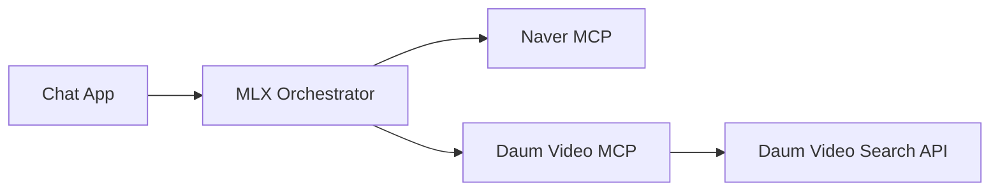

# Architecture

## Overview

`daum-video-mcp` is a dedicated Python repository for exposing Daum video search as MCP tools.

It should work in two modes:

- library mode
- FastMCP server mode

## Why A Separate Repository

The overall assistant stack already has a clear split:

- Naver MCP for general search, image, local, and trends
- MLX orchestrator for routing and synthesis

This repository exists to keep video search separate and focused.

Benefits:

- less overlap with other MCP servers
- clearer routing in the orchestrator
- simpler testing and operations

## System Context



## Responsibilities

- authenticate with Kakao REST API key
- call Daum video search endpoint
- normalize raw documents into stable result items
- expose MCP tools over `streamable-http`
- provide health and diagnostics endpoints

## Non-Goals

- non-video search
- local/map search
- final user reply formatting
- multi-MCP planning

## Internal Layers

```text
server.py
  -> tools_video.py
    -> client.py
    -> normalize.py
    -> models.py
    -> cache.py
```

### `config.py`

Stores:

- host and port
- transport path
- API key
- timeout and cache settings

### `client.py`

Owns raw HTTP calls to:

- `GET https://dapi.kakao.com/v2/search/vclip`

Responsibilities:

- request headers
- query parameter handling
- status code handling
- mapping failures into structured exceptions

### `normalize.py`

Converts raw Daum response documents into a stable schema.

Expected normalized fields include:

- `title`
- `link`
- `snippet`
- `source`
- `thumbnail_url`
- `published_at`
- `play_time`
- `author`

### `tools_video.py`

Exposes:

- `search_video`
- optional `search_video_auto`

### `server.py`

Defines:

- FastMCP server instance
- tool registration
- health endpoint

## Common Response Shape

Video search tools should return:

```json
{
  "query": "poker check raise lesson",
  "source": "daum_video",
  "items": [],
  "meta": {
    "pageable_count": 0,
    "total_count": 0,
    "is_end": true,
    "page": 1,
    "size": 10,
    "cached": false
  }
}
```

## Common Item Shape

```json
{
  "title": "normalized title",
  "link": "https://...",
  "snippet": "normalized contents",
  "source": "daum_video",
  "thumbnail_url": "https://...",
  "published_at": "2026-03-19T12:00:00+09:00",
  "play_time": 620,
  "author": "channel or site",
  "score": 0.0
}
```

Additional raw fields may be included if useful.

## Sorting Strategy

Initial support:

- `accuracy`
- `recency`

The tool should map these directly to Daum API semantics.

## Reliability Policy

- fail fast on timeout
- return structured errors
- do not expose raw internal stack traces
- keep cache conservative

## Cache Guidance

Recommended default:

- 5 to 10 minutes for identical queries

## Suggested Build Order

### Phase 1

- project scaffold
- config, client, errors
- normalize helpers
- `search_video`

### Phase 2

- tests
- optional cache
- health and diagnostics polish

### Phase 3

- optional `search_video_auto`
- better deduplication or ranking helpers

## Integration Guidance

The MLX orchestrator should prefer this MCP when:

- the user asks for videos
- the user mentions YouTube or lecture videos
- the user wants clips, highlights, or tutorials

Examples:

- `턴 체크레이즈 영상 찾아줘`
- `판교 소개 영상 보여줘`
- `유튜브로 김치찌개 영상 찾아줘`

The orchestrator should not use this repository for:

- images
- places
- general web or blog results
